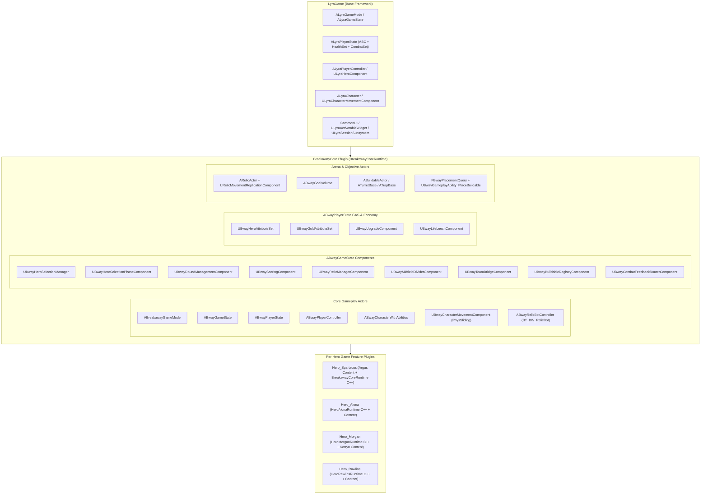

# Breakaway Project Architecture Overview (UE 5.8.1)

**Engine:** Unreal Engine `5.8.1` Source Build (`LyraEditor` / `LyraGame`)
**Last Reviewed:** October 20, 2026
**Companion Docs:** [Planning Hub](./README.md) · [Design Spec](./Breakaway_Reborn_Design_Spec.md) · [Project Roadmap](./PROJECT_ROADMAP.md) · [Master Goal Queue](./MASTER_GOAL_QUEUE.md) · [BreakawayCore Systems Index](../Plugins/GameFeatures/BreakawayCore/Docs/SYSTEMS_INDEX.md)

---

## 1. Module & Plugin Topology

`ProjectB` layers `BreakawayCoreRuntime` and modular per-hero Game Feature plugins on top of `LyraGame` without polluting engine modules:

### Per-Hero Game Feature Plugins

| Display Name | Plugin Folder | Runtime C++ Module | Kit Config DataAsset | Ability Classes | Buildable Class |
|---|---|---|---|---|---|
| **Argus** | `Plugins/GameFeatures/Heroes/Hero_Spartacus` | `BreakawayCoreRuntime` (hosted in core) | `UBwayArgusKitConfig` (`DA_BW_ArgusKitConfig`) | `UBwayGameplayAbility_MeleePrimary`, `UBwayGameplayAbility_ArgusSlide`, `UBwayGameplayAbility_NoRetreat`, `UBwayGameplayAbility_ForGlory`, `UBwayGameplayAbility_Retribution` | `ABwaySiegeEngineBuildable` |
| **Alona** | `Plugins/GameFeatures/Heroes/Hero_Alona` | `HeroAlonaRuntime` | `UBwayAlonaKitConfig` (`DA_BW_AlonaKitConfig`) | `UBwayGameplayAbility_AlonaPrimary` (`ABwayAlonaPrimaryProjectile`), `UBwayGameplayAbility_AlonaSunsGrace`, `UBwayGameplayAbility_AlonaRadiance`, `UBwayGameplayAbility_AlonaSunBurst`, `UBwayGameplayAbility_AlonaBlessing` (`ABwayAlonaBlessingZone`) | `ABwayAlonaSunShrineBuildable` |
| **Korryn** | `Plugins/GameFeatures/Heroes/Hero_Morgan` | `HeroMorganRuntime` | `UBwayKorrynKitConfig` (`DA_BW_KorrynKitConfig`) | `UBwayGameplayAbility_KorrynPrimary` (`ABwayKorrynPrimaryProjectile`), `UBwayGameplayAbility_KorrynFlock`, `UBwayGameplayAbility_KorrynBurdenOfSin`, `UBwayGameplayAbility_KorrynCircleOfSpite` (`ABwayKorrynSpiteZone`), `UBwayGameplayAbility_KorrynAuraOfSilence` | `ABwayKorrynCursedWardBuildable` |
| **Rawlins** | `Plugins/GameFeatures/Heroes/Hero_Rawlins` | `HeroRawlinsRuntime` | `UBwayRawlinsKitConfig` (`DA_BW_RawlinsKitConfig`) | `UBwayGameplayAbility_RawlinsPrimary` (2-shot burst), `UBwayGameplayAbility_RawlinsDoubleDown`, `UBwayGameplayAbility_RawlinsPowerShot`, `UBwayGameplayAbility_RawlinsSlideShot`, `UBwayGameplayAbility_RawlinsBlazingBarrage` (`ABwayRawlinsBulletProjectile`) | `ABwayRawlinsJailBuildable` + `ABwayRawlinsJailCage` |

---

## 2. `ABwayGameState` Authoritative Components

All match-wide rules and replicated state live on `ABwayGameState` (`Plugins/GameFeatures/BreakawayCore/Source/BreakawayCoreRuntime/Public/BwayGameState.h`) so late-joining and seamless-traveling clients converge deterministically:

| Component Property | C++ Class | Responsibility & Replicated State |
|---|---|---|
| `HeroSelectionManager` | `UBwayHeroSelectionManager` | Validates hero picks/locks (`FPlayerHeroSelectionArray`), bot auto-fill, and duplicate hero rules. |
| `HeroSelectionPhaseComponent` | `UBwayHeroSelectionPhaseComponent` | Staging lobby countdown, 5s post-lock settle timer, newcomer arrival cancellation, and `bTravelFailed` host retry latch. |
| `RoundManagementComponent` | `UBwayRoundManagementComponent` | Drives `Prematch` -> `Playing` -> `PostRound` -> `PostMatch` GAS phases, `Team1AliveCount`/`Team2AliveCount`, `OnPlayerDied` combat credit consumption, and `FPendingRespawn` timers. |
| `ScoringComponent` | `UBwayScoringComponent` | Tracks `Team1Score`, `Team2Score`, `RoundsToWin` (`3`), goal validation, and `FBwayMatchSummary` snapshots. |
| `RelicManagerComponent` | `UBwayRelicManagerComponent` | Spawns and tracks the singleton `ARelicActor` and goal volumes across round resets. |
| `MidfieldDividerComponent` | `UBwayMidfieldDividerComponent` | Evaluates `GetTerritorySide(RelicLocation)` (`Team1Territory`, `Team2Territory`, `Neutral`) for timer-expiry tiebreakers. |
| `TeamBridgeComponent` | `UBwayTeamBridgeComponent` | Synchronizes `ABwayGameState::Teams` (`0`/`1`) with `ULyraTeamSubsystem` (`1`/`2`) so friendly/enemy queries agree everywhere. |
| `BuildableRegistryComponent` | `UBwayBuildableRegistryComponent` | Tracks active `ABuildableActor` instances across rounds and enforces per-player active caps (`Siege=1`, `Shrine/Ward/Jail=3`). |
| `CombatFeedbackRouterComponent` | `UBwayCombatFeedbackRouterComponent` | Dispatches server-confirmed `GameplayCue.Breakaway.Combat.HitConfirm` with a scoped empty `FPredictionKey`. |

---

## 3. `ABwayPlayerState` GAS, AttributeSets & Economy Components

`ABwayPlayerState` (`BwayPlayerState.h`) owns the persistent `ULyraAbilitySystemComponent` across pawn deaths and round resets:

| Subobject / Replicated Field | C++ Type | Attributes / Replicated Fields & Purpose |
|---|---|---|
| `AbilitySystemComponent` | `ULyraAbilitySystemComponent` | Inherited from `ALyraPlayerState`; persists ability grants, cooldowns, and upgrade GameplayEffects across pawn replacement. |
| `HealthSet` / `CombatSet` | `ULyraHealthSet` / `ULyraCombatSet` | Inherited Lyra sets (`Health`, `MaxHealth`, `Damage`, `Healing` meta-attributes). |
| `HeroAttributeSet` | `UBwayHeroAttributeSet` | `AttackStrength`, `Armor`, `MoveSpeedRating`, `MoveSpeedMultiplier`, `IncomingDamageMultiplier`, `CooldownReduction` (`[0,1]`), `LifeLeech` (`[0,1]`), `RespawnTimeReduction` (`[0,1]`). |
| `GoldAttributeSet` | `UBwayGoldAttributeSet` | `CurrentGold`, `MaxGold` (`500.0`), `GoldPerSecond` passive income. |
| `UpgradeComponent` | `UBwayUpgradeComponent` | Server-validated shop purchases (`ServerTryPurchaseUpgrade`), 4-slot cap (`MaxEquippedUpgrades=4`), replicated `OwnedUpgrades`, and match reset (`ResetUpgradesForNewMatch`). |
| `LifeLeechComponent` | `UBwayLifeLeechComponent` | Authority listener on enemy player post-clamp health loss; heals attacker by `ActualDamage * LifeLeech` with reentrancy guard. |
| Replicated Match Telemetry | `ABwayPlayerState` properties | `SelectedHeroId`, `bHeroLocked`, `PlayerNum`, `bHasRelic`, `bHasCalledForRelic`, `bHasPlacedBuildableThisRound` (`COND_OwnerOnly`), `RespawnSchedule` (`FBwayRespawnSchedule`), `Kills`, `Deaths`, `Assists`, `ObjectiveScore`, `DamageDealt`, `HealingDone`, `ForcedFumbles`, `Interceptions`, `BuildablesDestroyed`, `MatchGoldEarned`. |

---

## 4. End-to-End Front-End to In-Match UI & State Flow

```mermaid
sequenceDiagram
    participant MainMenu as W_MainMenu (UI.Layer.Menu)
    participant ModeSel as W_ModeSelection (UI.Layer.Menu)
    participant Browser as W_LocalMatchBrowser (UI.Layer.Menu)
    participant Lobby as W_MatchLobby + W_MatchSettingsModal
    participant HeroSel as W_HeroSelection (L_BW_Dorado Prematch)
    participant Intro as Arena Intro Fly-Through (5.5s Camera Pan)
    participant Shop as W_MatchShop (15s Warmup on UI.Layer.Modal)
    participant Match as Active Match HUD (Playing Phase)

    MainMenu->>ModeSel: Click PLAY -> Push W_ModeSelection
    ModeSel->>Browser: Click LOCAL / CUSTOM -> Push W_LocalMatchBrowser
    Browser->>Lobby: Click HOST MATCH ("CREATING SERVER...") -> Push W_MatchLobby
    Lobby->>Lobby: MATCH OPTIONS -> W_MatchSettingsModal (Map, Enable Bots, Bot Difficulty)
    Lobby->>HeroSel: Click START -> OpenLevel(L_BW_Dorado?listen?ArenaIntro=1?NumBots=7?BotDifficulty=...)
    HeroSel->>Intro: Pick Hero (3D ABwayHeroPreviewActor) & Click READY! (99s timer) -> Lock Humans & Auto-Fill Bots
    Intro->>Shop: 5.5s Shrine of Auros / Relic Pan Complete -> EnterWarmup (Spawn Heroes + Grant 1000 Gold)
    Shop->>Match: Buy/Sell/Undo Upgrades -> 15s Timer Hits 0 (or ESC) -> Auto-Close Shop & Start Round 1
```

### Front-End & Pre-Round Widget Pipeline (`BreakawayCoreRuntime`)

| Screen / Asset | C++ Base Class | Layer Tag | Key Responsibilities |
|---|---|---|---|
| `/BreakawayCore/UI/FrontEnd/W_MainMenu` | `UBwayMainMenuWidget` | `UI.Layer.Menu` | Left-aligned navigation (`PLAY`, `WARRIORS`, `HELP`, `SETTINGS`, `QUIT`) and top-right persistent party/profile header bar. Auto-pushed on `L_LyraFrontEnd`. |
| `/BreakawayCore/UI/FrontEnd/W_ModeSelection` | `UBwayModeSelectionWidget` | `UI.Layer.Menu` | 5 angled mode cards (`TUTORIAL`, `ARENA`, `VERSUS AI`, `CUSTOM`, `LOCAL` with `"Host a local server. For dev testing only."` hover description) and `CANCEL` button. |
| `/BreakawayCore/UI/FrontEnd/W_LocalMatchBrowser` | `UBwayLocalMatchBrowserWidget` | `UI.Layer.Menu` | LAN/local session query via `UCommonSessionSubsystem` (`REFRESHING SERVER LIST...` -> `NO GAMES IN PROGRESS` or discovered rows), manual `REFRESH`, and `HOST MATCH` (`CREATING SERVER...` overlay). |
| `/BreakawayCore/UI/FrontEnd/W_MatchLobby` | `UBwayMatchLobbyWidget` | `UI.Layer.Menu` | Map header (`THE SHRINE OF AUROS`), `MATCH OPTIONS`, `INVITES` selector, read-only summary (`Bots Enabled`, `Bot Difficulty`, `Invites`), 3x4 team roster grid (`BLUE TEAM`, `RED TEAM`, `SPECTATORS`), `Leave`, `Settings`, and `START`. |
| `/BreakawayCore/UI/FrontEnd/W_MatchSettingsModal` | `UBwayMatchSettingsModalWidget` | `UI.Layer.Modal` | Map carousel (`FBwayMapOptionEntry`), `ENABLE BOTS` toggle, `BOT DIFFICULTY` (`NORMAL` / `ELITE` bound to `ABwayRelicBotController` Blackboard), `ACCEPT`, and `CANCEL`. |
| `/BreakawayCore/UI/HeroSelect/W_HeroSelection` | `UBwayHeroSelectWidget` | `UI.Layer.Menu` | 99s `ASSEMBLE TEAM` timer, selected hero header (`Name`, `Role`, `Level 99`), 3-column skewed portrait grid with `P1` badge, `READY!` -> `LOCKED IN` with `VoiceBank` playback, `ABwayHeroPreviewActor` 3D character preview, and `SKINS`/`TAUNTS`/`WEAPONS`/`ABILITIES` sub-panels. |
| `/BreakawayCore/UI/Match/W_MatchShop` | `UBwayUpgradeShopWidget` | `UI.Layer.Modal` | Auto-opens on `EnterWarmup` (`15s` top-center countdown) with `1000` starting gold, 3-column categorized upgrade grid (`ATTACK`, `DEFENSE`, `MISC` + `RECOMMENDED` badge), 4-slot inventory bar, and right-side Tier I–IV inspector with `BUY`, `SELL`, and `UNDO`. |

- **Rematch (`ABwayGameState::RequestRematch`):** Resets scores, round counters, buildables, player stats, gold, and purchased upgrades (`ResetForNextMatch`) and starts a fresh Best-of-5 series or returns to staging hero selection.
- **Connected Lobby Return (`ABwayGameState::ReturnToFrontEnd`):** Host executes `World->ServerTravel("/BreakawayCore/Maps/L_Bway_HeroSelect?listen")`, keeping all connected clients on the active listen `NetDriver` port without dropping their session.
- **End-to-End Verification Command (`bway.Test.FrontEndToMatchFlow` / `bway.Test.FrontEndToMatchFlowExit`):** Native `FTSTicker` verification harness in `BwayFrontEndFlowWidgets.cpp` that drives and validates all 8 steps from `W_MainMenu` on `L_LyraFrontEnd` through `W_MatchShop` and Round 1 active spawn on `L_BW_Dorado`.

---

## 5. Current Architectural Debt & Scheduled Cleanups

1. **Legacy `ABreakawayGameMode` Round/Relic Methods (Scheduled in Goal 3):**
   - `ABreakawayGameMode` still contains deprecated duplicate methods (`StartRound`, `EndRound`, `ScoreGoal`, `SpawnRelic`, `ResetArenaForNextRound`) and `TeamScores`/`RoundState` properties superseded by `UBwayRoundManagementComponent`, `UBwayScoringComponent`, and `UBwayRelicManagerComponent`.
2. **Seamless Travel Read-Only NetGUID Warnings (Scheduled in Goal 3):**
   - Staging (`L_Bway_HeroSelect`) to Arena (`L_Dorado`) seamless travel logs `LogRep: Warning: Attempt to reassign read-only NetGUID` (tracked in [TRAVEL_GUID_INVESTIGATION.md](./TRAVEL_GUID_INVESTIGATION.md)).
3. **Argus C++ Module Hosting:**
   - Argus C++ ability classes (`UBwayGameplayAbility_NoRetreat`, `ForGlory`, `Retribution`, `ArgusSlide`) and `ABwaySiegeEngineBuildable` currently reside in `BreakawayCoreRuntime` while `Hero_Spartacus` is content-only; Alona, Korryn, and Rawlins use dedicated `Hero<Name>Runtime` C++ modules. New heroes (Goals 5 & 6) must follow the dedicated `Hero<Name>Runtime` module pattern.
4. **Dorado VSM Non-Nanite Job Queue Overflow (Scheduled in Goal 3/4):**
   - `L_Dorado` logs non-Nanite Virtual Shadow Map job queue overflows on static environment meshes that should be converted to Nanite or routed through `r.Shadow.Virtual.NonNanite.IncludeInCoarsePages`.
