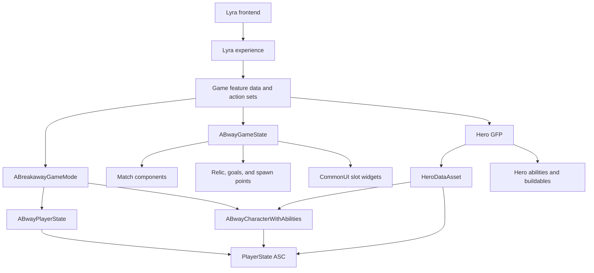

# BreakawayCore Game Feature Plugin systems

This page is the canonical map of the BreakawayCore Game Feature Plugin (GFP). Use it to find the owner of a system, the assets that configure it, and the next document to read.

**Last reviewed:** September 6, 2026

BreakawayCore is a Lyra extension for the Capture-the-Relic vertical slice. Runtime behavior lives in the `BreakawayCoreRuntime` module. Authored content lives in the plugin content mount. Four optional hero GFPs add hero-specific data, abilities, buildables, and presentation.

For changing priorities and verification status, see the [vertical slice status ledger](../../../../AI_Planning/SLICE_STATUS.md). For ordered implementation checklists, see the [core loop implementation plan](./CoreLoop_Implementation_Plan.md).

## Understand the plugin contract

The plugin contract is defined by [`BreakawayCore.uplugin`](../BreakawayCore.uplugin):

| Contract | Repository behavior |
|---|---|
| Runtime module | `BreakawayCoreRuntime`, loaded in the default phase. |
| Content | Enabled with `CanContainContent=true`, mounted at `/BreakawayCore/`. |
| Feature state | Explicitly loaded, with `BuiltInInitialFeatureState` set to `Loaded`. |
| Required systems | Game Features, ShooterCore, ShooterExplorer, CommonGame, ModularGameplay, GameplayAbilities, and ShooterCTF. |
| Project modules | The root project builds `LyraGame` and `LyraEditor`. BreakawayCore is a plugin module compiled into those targets. |
| Optional roster | `Hero_Spartacus`, `Hero_Alona`, `Hero_Morgan`, and `Hero_Rawlins` are separate GFPs that depend on BreakawayCore. |

The project file enables the BreakawayCore and hero plugins for editor and project availability. The active experience still determines which game feature content participates in a mode through its `GameFeaturesToEnable` list and feature data.

Do not add optional hero content as a hard reference from core assets. The project enables asset reference restrictions for Game Feature content. Keep optional references in the hero plugin and activate the plugin through the experience or the supported loader.

## See the system layers

The runtime follows Lyra's experience-driven, component-based structure:



The main dependency direction is:

```text
Lyra foundation → BreakawayCore → hero GFPs and mode content
```

Core systems may define contracts for hero plugins. Core systems should not discover hero-specific objects through global actor scans or concrete references.

## Use the correct owner and lifetime

The following table is the primary ownership guide. Mutable match state belongs in runtime objects. Authored definitions belong in data assets.

| Owner | Lifetime and authority | Use it for |
|---|---|---|
| `ABreakawayGameMode` | One server-only instance per world. | Login and logout, team assignment, pawn restart, hero application, and initial world-object spawning. |
| `ABwayGameState` | One replicated instance per world. | Team data, match-facing events, result travel, and the canonical set of match components. |
| `ABwayPlayerState` | One replicated instance per player. It survives pawn respawn. | Hero selection, relic flags, player number, match statistics, gold ASC, and upgrade ownership. |
| `ABwayCharacterWithAbilities` | A replicated in-match pawn. It can be replaced during respawn. | Hero visuals, hero ability grants, movement, team appearance, and pawn-side relic interaction. |
| `UGameStateComponent` | Owned by `ABwayGameState`; replicated when its state requires it. | A focused match service such as rounds, scores, relic state, or buildable registration. |
| `UBwayHeroRegistry` | A `UGameInstanceSubsystem` that survives map travel in one process. | Asset Manager discovery and loading of hero data assets. |
| `UPrimaryDataAsset` or `UDataAsset` | Authored definition; do not store mutable session state here. | Hero, buildable, match-flow, movement, combat-readability, and relic configuration. |
| CommonUI widget | Local presentation lifetime. | Reading replicated state, binding to local delegates, and presenting the current match. |

### GameState component ownership

`ABwayGameState` creates the following components as C++ default subobjects in its constructor:

| Component | Responsibility |
|---|---|
| `UBwayHeroSelectionManager` | Registers players, tracks selections, validates availability, and enforces lock rules. |
| `UBwayHeroSelectionPhaseComponent` | Integrates hero selection with Lyra phase abilities and player-facing UI. |
| `UBwayRoundManagementComponent` | Owns match-flow orchestration, round timing, win conditions, respawn timing, and gold awards. |
| `UBwayScoringComponent` | Owns replicated team scores and score-change events. |
| `UBwayRelicManagerComponent` | Owns the active relic reference, reset flow, carrier tracking, and damage-triggered fumbles. |
| `UBwayMidfieldDividerComponent` | Owns the sudden-death midfield rule and its world actor. |
| `UBwayTeamBridgeComponent` | Synchronizes Breakaway team indices with Lyra team IDs. |
| `UBwayBuildableRegistryComponent` | Tracks placed buildables for server-side limits, persistence, and replicated queries. |
| `UBwayCombatFeedbackRouterComponent` | Routes combat feedback messages to the local presentation systems. |

`UBwaySpawnPointManagerComponent` is different. `ABreakawayGameMode::InitGameState()` adds it to the GameState at runtime when it is not already present, then `BeginPlay()` discovers placed spawn points.

Do not add a second copy of these components to `BP_BW_GameState`. Configure the C++ default subobjects or the owning data assets instead.

## Follow the load and startup sequence

The following sequence describes the normal world startup path:

1. `ABreakawayGameMode::InitGame()` registers packaged Breakaway experiences and merges URL options into the authoritative `OptionsString`.
2. `ABreakawayGameMode::InitGameState()` creates `ABwayGameState` and ensures the runtime spawn-point manager exists.
3. Lyra loads the selected experience and its feature data, action sets, input, widgets, and phase configuration.
4. `ABwayGameState` initializes its C++ default subobjects. Each component binds to the lifecycle it owns.
5. `ABreakawayGameMode::BeginPlay()` initializes spawn tags and defers initial relic and goal spawning by one tick so level actors can finish registration.
6. Players enter through `PostLogin()` or seamless-travel startup. The GameMode assigns teams, applies a `Hero=` URL selection when present, and defers pawn restart when match flow or hero selection owns the spawn gate.
7. The selected hero data is applied after pawn restart. The server grants ability sets to the persistent PlayerState ASC and replicates the hero ID for client-side visual setup.

The important boundary is that the GameMode owns player lifecycle, while GameState components own domain state. Older code paths still exist on the GameMode; prefer the GameState component APIs when the two overlap.

## Follow match flow

`UBwayRoundManagementComponent` is the sole phase orchestrator when `UBwayMatchFlowConfig::bOrchestrateMatchFlow` is `true`.

```text
Prematch → Warmup → Playing → PostRound → Playing … → PostMatch
```

| Phase | Entry point | Main behavior |
|---|---|---|
| Prematch | `EnterPrematch()` | Holds pawn spawning and starts the configured prematch phase ability. |
| Warmup | `EnterWarmup()` | Restarts deferred players and bots, then runs the warmup timer once per match. |
| Playing | `EnterPlaying()` | Starts the playing phase and the round FSM. |
| PostRound | `EnterPostRound()` | Publishes the round summary, starts the post-round phase, and either returns to Playing or advances to PostMatch. |
| PostMatch | Internal RM transition | Stops round processing and starts the results flow. |

The top-level `EBwayMatchPhase` enum contains `None`, `Prematch`, `Warmup`, `Playing`, `PostRound`, and `PostMatch`. Hero selection is not an RM phase. The production path uses the hero-select staging map. Direct PIE can use the hero URL, the direct-play hero UI, or a skip flag. See [match flow and phases](./MatchFlow_and_Phases.md) and [hero select staging setup](./HeroSelect_Staging_Setup.md).

`UBwayMatchFlowLibrary::ResolveMatchFlowSettings()` combines the selected `UBwayMatchFlowConfig` with URL overrides. The main development asset is `DA_BW_MatchFlow_Dev`. Attach it through `UBwayGameFeatureAction_MatchFlowConfig` on the experience Actions list or an action set. Do not reparent `B_BW_Experience_Dev` to `UBwayExperienceDefinition`.

## Understand the core gameplay systems

### Hero system

`UBwayHeroDataAsset` is the primary data contract. It contains:

- Display text, class, portrait, and optional voice bank.
- Hero mesh, animation Blueprint, relative mesh transform, and mesh validation requirements.
- `FHeroStats` values for health, base damage, armor, and movement speed.
- An attribute-set class and one or more Lyra ability sets.
- One `UBwayBuildableDataAsset` reference.
- An optional movement-feel configuration.

`UBwayHeroRegistry` discovers assets through the `HeroDataAsset` primary asset type. `UBwayHeroSelectionManager` owns server-side selection state. `UBwayHeroSelectWidget` reads registry data locally and sends selection and lock requests through `ABwayPlayerState` server RPCs.

The current roster is split between four hero GFPs:

| Display name | Plugin | Unreal content mount | Runtime module | Buildable |
|---|---|---|---|---|
| Argus | `Hero_Spartacus` | `/Hero_Spartacus/Characters/Heroes/Argus/` | Core `BreakawayCoreRuntime` | Siege Engine |
| Alona | `Hero_Alona` | `/Hero_Alona/Characters/Heroes/Alona/` | `HeroAlonaRuntime` | Sun Shrine |
| Korryn | `Hero_Morgan` | `/Hero_Morgan/Characters/Heroes/Hexweaver/` | `HeroMorganRuntime` | Cursed Ward |
| Rawlins | `Hero_Rawlins` | `/Hero_Rawlins/Characters/Heroes/Gunslinger/` | `HeroRawlinsRuntime` | Jail |

For per-hero assets and editor wiring, see [hero plugin setup](../../Heroes/README.md) and the [hero codename map](../../../../AI_Planning/HERO_CODENAME_MAP.md).

### Ability system

Breakaway abilities extend Lyra's Gameplay Ability System (GAS) classes. The common humanoid ability set owns shared actions such as slide, Request Relic, and placement confirm/cancel. Each hero ability set owns the hero's primary, F/Q/E/R abilities, and the hero-specific `PlaceBuildable` ability.

The persistent Ability System Component (ASC) is on the PlayerState through Lyra. `ABwayCharacterWithAbilities::InitializeHeroData()` clears tracked hero grants, gives the selected hero's ability sets, applies hero stats, and applies mesh and animation data. This keeps hero grants stable across pawn replacement.

Input is data-driven:

| Concern | Location |
|---|---|
| Shared and hero Input Actions | `/BreakawayCore/Input/Actions/` |
| Shared, hero, and relic mappings | `/BreakawayCore/Input/Mappings/` |
| Ability input tags | `Config/Tags/BreakawayCore.ini` |
| Grant-to-input association | Lyra ability set assets |

For activation blocking, placement, and Gameplay Cue rules, see [GAS and abilities](./GAS_and_Abilities.md).

### Relic and scoring

`ARelicActor` is the replicated objective actor. Its state machine is:

```text
Neutral → Carried → Dropped / Thrown / BeingPassed → Neutral
                         └→ Scoring → Resetting → Neutral
```

The relic owns replicated state, current carrier, last possessing team, and the per-round scoring flag. `UBwayRelicManagerComponent` owns the active relic, reset flow, and the carrier-damage subscription. `ABwayGoalVolume` detects goal overlap and routes scoring to round management.

Throw and pass use server RPCs with client prediction and unreliable cosmetic multicast effects. Physics movement uses `URelicMovementReplicationComponent`, which interpolates replicated movement and applies a 600-centimeter snap threshold. Do not enable `AActor::bReplicateMovement` on the relic; it conflicts with the custom movement component.

For the full state and interaction contract, see [the Relic system reference](./Relic_System.md). For the server/client test matrix, see [networking](./Networking.md).

### Buildables

`ABuildableActor` extends `ABwayActorWithAbilitiesAndHealth`. It owns build progress, activation, team ownership, destruction, replicated visual mesh, and the persistence flag. `UBwayBuildableDataAsset` selects the actor class, preview or runtime mesh, per-player cap, and an authored cost. The vertical slice uses once-per-round, free placement; the cost field is not the payment path.

Placement is a three-part contract:

1. The hero ability set grants `UBwayGameplayAbility_PlaceBuildable` through `InputTag.Ability.Buildable`.
2. The targeting actor validates the trace, surface, angle, overlap, and buildable placement rules while showing a preview.
3. The server calls `UBwayBuildablePlacementLibrary::SpawnBuildableForPlayer()` and registers the actor with `UBwayBuildableRegistryComponent`.

The common humanoid ability set owns confirm and cancel. `State.BuildablePlacement` blocks primary attack and Request Relic while the preview is active. `Ability.Buildable.PlacementExempt` prevents confirm, cancel, and placement-start abilities from canceling their own session.

The four slice buildables are Siege Engine, Sun Shrine, Cursed Ward, and Jail. They persist between rounds unless destroyed. For the complete placement lifecycle, see [the Buildable system reference](./Buildable_System.md).

### Economy

`UBwayGoldAttributeSet` lives on the PlayerState ASC and exposes `CurrentGold`, `MaxGold`, and `GoldPerSecond`. Server-side Gameplay Effects modify the values. Round management applies passive income during `RoundActive` and awards configured kill and objective gold.

Gold persists between rounds in a match. A new match starts with new session state; the vertical slice does not save gold. The upgrade catalog, owner-replicated ranks, and shop types exist in the source tree; the remaining match-upgrade gate is packaged UI, separate-process transport, and lifecycle verification. See [economy and gold](./Economy_Gold.md) and the [status ledger](../../../../AI_Planning/SLICE_STATUS.md) before changing this boundary.

### Bots and movement

`UBwayBotCreationComponent` backfills the configured player count. The relic bot uses `BwayRelicBotController`, the `BB_BW_RelicBot` Blackboard, the `BT_BW_RelicBot` behavior tree, and the relic-specific tasks and service under `Source/BreakawayCoreRuntime/Public/AI/`.

`UBwayCharacterMovementComponent` extends Lyra movement with slide, wall-run gravity, and custom movement modes. Common slide is distinct from Argus's hero defense ability, even though both can be presented as a slide-like action.

## Understand the UI contract

BreakawayCore uses Lyra and CommonUI extension points. The experience action set `EAS_BW_CaptureTheRelic` injects slot widgets into a HUD layout. The C++ widget bases read authoritative GameState or PlayerState data; Blueprint assets own layout and art.

| Slot tag | Current widget | Native base |
|---|---|---|
| `HUD.Slot.TeamScore` | `W_BW_CaptureTheRelic_ScoreWidget` | `BwayCaptureTheRelicScoreWidget` |
| `HUD.Slot.ModeStatus` | `W_BW_RelicStatusWidget` | `BwayRelicStatusWidget` |
| `HUD.Slot.Health` | `W_BW_HealthWidget` | `BwayHealthHUDWidget` |
| `HUD.Slot.TeamPortraits.Friendly` | `W_BW_TeamPortraitsWidget` | `BwayTeamPortraitsHUDWidget` |
| `HUD.Slot.TeamPortraits.Enemy` | `W_BW_TeamPortraitsWidget_Enemy` | `BwayTeamPortraitsHUDWidget` |
| `HUD.Slot.AbilityBar` | `W_BW_AbilityBar` | `BwayAbilityBarHUDWidget` |
| `HUD.Slot.Gold` | `W_BW_GoldWidget` | `BwayCurrencyDisplayWidget` |

The deprecated monolithic `UBwayCoreHUDWidget` and its Blueprint should not be reintroduced into the experience. Team index `0` and `1` remain authoritative in gameplay. The HUD maps the local player's team to the friendly display slot and keeps spectator display deterministic.

For widget inheritance, required bindings, and action-set wiring, see [the UI system reference](./UI_System.md) and [the match HUD setup guide](./CoreHUD_Layout_Setup.md).

## Use the content and source layout

### Core plugin content

The core content mount is `/BreakawayCore/`. The main folders are:

| Folder | Purpose |
|---|---|
| `Abilities/` | Common abilities and buildable placement assets. |
| `Bots/` | Bot controllers, Blackboard, behavior tree, and services. |
| `Characters/` | Humanoid character, pawn data, common ability set, and player state Blueprint. |
| `CombatFeedback/` | Combat-readability data and visual configuration. |
| `Economy/` | Match-upgrade catalog data. |
| `Experiences/` | Dev, Capture-the-Relic, Ball Mode, staging, action sets, and phase assets. |
| `GameModes/` | GameMode and GameState Blueprints plus Ball Mode objective assets. |
| `GameplayCues/` and `GameplayEffects/` | Cue assets, damage effects, relic request, and phase effects. |
| `Input/` | Input Actions, Input Mapping Contexts, and humanoid input data. |
| `Maps/` | `L_BW_DevMap`, `L_BW_Dorado`, front-end, and hero-select staging maps. |
| `MatchFlow/` | `DA_BW_MatchFlow_Dev`. |
| `Movement/` | `DA_BW_MovementFeel_Default`. |
| `UI/` | Frontend, hero-select, match HUD, fonts, icons, materials, and result widgets. |

### Hero plugin content

Each hero plugin uses a stable pattern:

```text
Plugins/GameFeatures/Heroes/<Plugin>\
  <Plugin>.uplugin
  Content/
    Characters/Heroes/<Codename>/
      DA_BW_HeroData_<Codename>
      DA_BW_AbilitySet_<Codename>
      Abilities/
      Buildable/
      UI/
  Content/Kit/
  Source/<HeroRuntime>/
```

The plugin-root asset (`Hero_*.uasset`) is a `UBwayGameFeatureData` asset. Its `HeroDataAssets` array registers the hero data asset with the game feature. The `HeroDataAsset` primary asset scan paths are registered in `Config/DefaultGame.ini`.

### Translate disk paths and Unreal paths

Use the correct form for the tool you are using:

| Disk location | Unreal package mount |
|---|---|
| `Content/...` | `/Game/...` |
| `Plugins/GameFeatures/BreakawayCore/Content/...` | `/BreakawayCore/...` |
| `Plugins/GameFeatures/Heroes/Alona/Content/...` | `/Hero_Alona/...` |
| `Plugins/GameFeatures/Heroes/Morgan/Content/...` | `/Hero_Morgan/...` |

The operating-system path is useful for `rg`, scripts, and source control. The Unreal mount is required by asset references, `LoadObject`, Asset Manager settings, and editor tools.

## Choose the next document

| Goal | Start here |
|---|---|
| Learn Lyra ownership and feature activation | [Lyra integration](./Lyra_Integration.md) |
| Change match phases, durations, or win rules | [Match flow and phases](./MatchFlow_and_Phases.md) |
| Change relic state, scoring, or latency behavior | [Relic system](./Relic_System.md) and [networking](./Networking.md) |
| Add or change a buildable | [Buildable system](./Buildable_System.md) |
| Add or change a hero ability | [GAS and abilities](./GAS_and_Abilities.md) and the relevant hero setup page |
| Change the match HUD or results | [UI system](./UI_System.md) and [match HUD setup](./CoreHUD_Layout_Setup.md) |
| Change spawn points or goal placement | [Spawn point system](./SpawnSystem_README.md) |
| Verify a C++ change | [Agent testing ladder](./Agent_Testing_Ladder.md) and the live [test-script README](../../../../Scripts/Test/README.md) |
| Learn the repository in order | [BreakawayCore onboarding tutorial](./BreakawayCore_Onboarding.md) |

## Preserve these boundaries

- Keep match authority in the server GameMode, GameState components, or server-owned PlayerState paths.
- Keep mutable runtime state out of Data Assets and class defaults.
- Bind delegates once during a defined lifecycle and unbind when the widget, component, or publisher is destroyed.
- Use a direct reference for a configured one-to-one relationship, an interface for a shared target contract, an event dispatcher for one publisher with many listeners, and a scoped message router for deliberate many-to-many communication.
- Do not use `Get All Actors of Class` as routine dependency injection.
- Do not put match orchestration in Level Blueprints when it belongs to the GameState component or experience.
- Test a C++ compile separately from a PIE, listen-server, latency, or packaged-build result.
